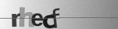

# What is a captcha code?

<p class="post-meta">By <a href="https://halit.org">Halit Sever</a> · <time datetime="2026-11-28">28 November 2026</time></p>

<p class="lead">A captcha code is the short string of warped letters or digits that a form asks you to type. The site generated it a moment earlier, drew it into an image with noise on top, and kept the real text on its server. This page shows how such an image is made, using the generator in this repository.</p>

## What you are looking at

Here are real E-captcha images from the repository's `samples/` folder. The file names end in the text each image holds:

<p class="samples">
  
  
  
</p>

Each one is a 200 x 50 image with five lowercase letters. The letters are dark or mid-grey, slightly rotated and packed close together, on a background that fades from light on the left to darker on the right, with a line or two drawn across.

## How a captcha code is generated

`gen_synthetic.py` in the repository draws images in the same style, to train the model when real labelled images are scarce. Its steps are a fair picture of how most text captchas are made:

1. **Pick the text.** Five characters at random from the alphabet `abcdefghjkmnrstuvyz`. That set has 19 letters and leaves out i, l, o, p, q, w and x. Dropping look-alike characters is common in text captchas, so a person is not asked to tell `l` from `1`.
2. **Paint the background.** A horizontal gradient from about 245-255 grey on the left to 120-145 on the right, darkened slightly towards the bottom.
3. **Draw each letter on its own.** A random bold sans-serif font at 40-48 px, plus or minus 2 px per letter. About 60% of letters are dark (grey 15-80) and the rest lighter (105-175), so some letters barely stand out from the darker side of the background.
4. **Rotate and place.** Each letter turns by up to 7 degrees either way and moves up or down by up to 2 px. The next letter starts at 62-82% of the previous letter's width, so neighbours overlap.
5. **Add clutter.** One or two straight lines cross the whole image, and in 60% of images Gaussian noise is added on top.
6. **Save the answer.** The script writes the file name and the text to a CSV. A website would store the text in the session instead and send only the image.

```bash
python gen_synthetic.py --n 5000 --out synth --labels synth_labels.csv
```

With 19 letters and 5 positions there are 19<sup>5</sup> = 2,476,099 possible codes, so guessing is not an option. The defence has to come from the image being hard to read.

## Is a captcha code case sensitive?

It depends on the site. Many text captchas, E-captcha included, use only lowercase or ignore case when they compare. If a form keeps rejecting a code you are sure you read correctly, try it the way it is drawn, and ask for a new image if you cannot read one.

## How OCR reads a captcha code

A person reads the code by recognising letter shapes. A program can learn the same thing from examples. This repository trains a small CRNN on labelled images of this one style; the [step-by-step OCR walk-through](/blog/how-captcha-ocr-works) shows how it turns an image into the five letters and a confidence score. That model only reads E-captcha. Another site's codes would need their own labelled data and a new training run.

## "What is this captcha?"

If a site shows a captcha you did not expect, the [challenge-response explainer](/blog/what-is-a-captcha-challenge) covers why it appears and the other kinds you may meet, from checkboxes to invisible scores.

## FAQ

### Why are some letters missing from captcha codes?

Letters that look alike, such as l and 1 or o and 0, are often left out so people are not asked to guess. E-captcha uses 19 letters and no digits.

### What happens if I type the code wrong?

The site rejects the form and usually shows a new image. Most sites limit the number of attempts.

## Related posts

- [What is a CAPTCHA challenge-response test?](/blog/what-is-a-captcha-challenge)
- [Math CAPTCHAs: how they work and where they fall short](/blog/mathematical-captcha)
- [How captcha OCR works, step by step](/blog/how-captcha-ocr-works)
- [All posts](/blog/)
